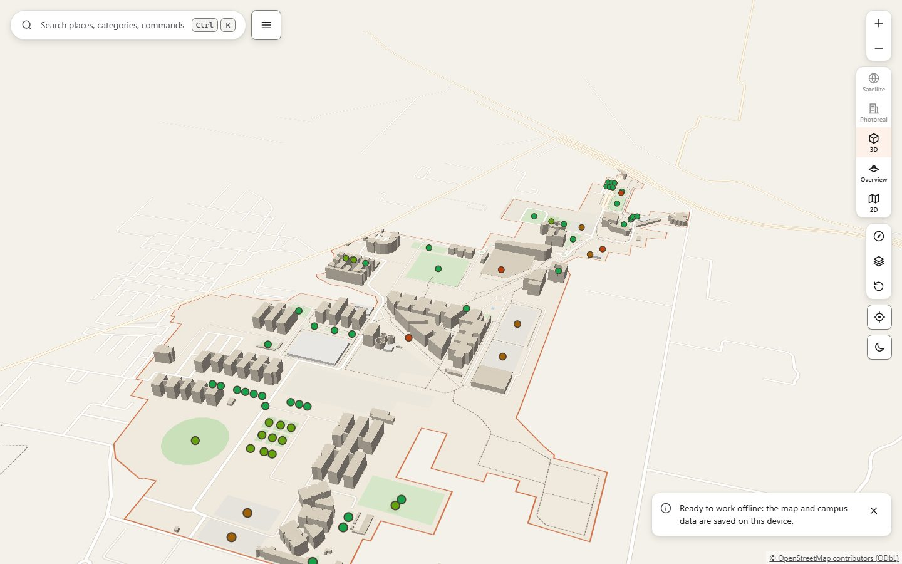
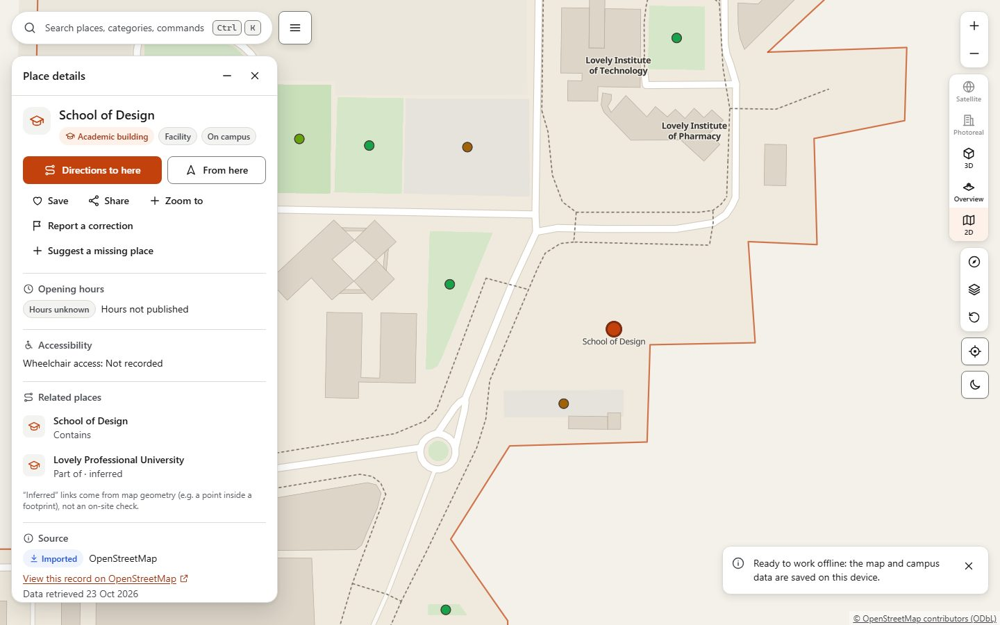
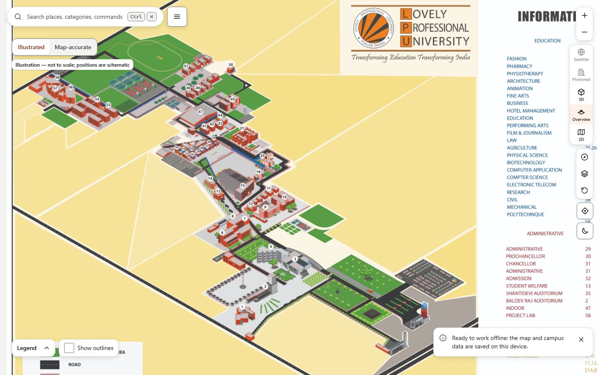
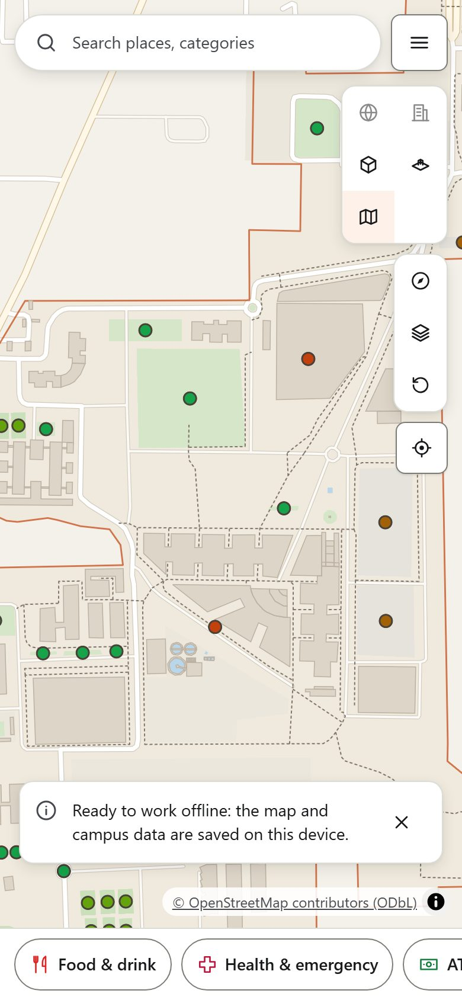

# LPU Campus Atlas

A campus map with search and walking/cycling directions for **Lovely Professional University**
(Phagwara, Punjab, India). It ships as an installable, offline-capable web app (PWA). It is built
only from verifiable open data, mainly [OpenStreetMap](https://www.openstreetmap.org/), plus a short
list of official LPU school and facility names cited from `www.lpu.in`.

The app reports what the data says and no more. An unnamed building is shown as "Unnamed building".
Unknown hours show as unknown. A facility nobody has mapped gets an honest empty state. A route that
the mapped paths cannot support is reported as "no path"; the app does not draw a straight line
instead.

> This is an independent project. It is not an official LPU product and is not endorsed by Lovely
> Professional University. Confirm anything important with the university.

## Contents

- [Features](#features)
- [Screenshots](#screenshots)
- [Quick start](#quick-start)
- [Testing](#testing)
- [Campus data](#campus-data)
- [Licensing of data](#licensing-of-data)
- [Environment variables](#environment-variables)
- [Admin setup](#admin-setup)
- [Deployment](#deployment)
- [Troubleshooting](#troubleshooting)
- [Known limitations](#known-limitations)
- [Project layout](#project-layout)
- [Documentation](#documentation)
- [Credits](#credits)

## Features

Everything below exists in the current code. Features that depend on data LPU does not publish are
listed under [Known limitations](#known-limitations).

**Map**

- A MapLibre GL map drawn from the project's own GeoJSON: campus boundary, roads, paths, green
  areas, water and building footprints. By default there are no third-party tiles and no API key;
  satellite imagery is optional (see [Map providers](#map-providers-free-sources-only)). The map
  glyphs (Noto Sans) are self-hosted.
- Five view modes in one "View mode" switcher in the map controls (or the `?view=` deep link):
  **Satellite map** (`satellite`), **Photorealistic 3D** (`earth`, always unavailable, see below),
  **3D map** (`3d`: our buildings and owner-placed models, on satellite imagery when it is
  configured), **Isometric overview** (`iso`: the Illustrated overview by default, or a Canvas2D
  map-accurate drawing; neither needs WebGL) and **2D map**
  (`2d`). Selection, search, saved places and the planned route are shared: switching keeps the
  selected building and opens on the same ground point. The app starts in 3D on screens 768 px and
  wider and in 2D on phones. A mode that cannot be used stays visible with its reason (a toast and
  an announcement when chosen), never hidden and never faked: Satellite without a configured free
  source, Photorealistic 3D always, the overview during live navigation. Live location and
  navigation use a map mode; starting either from the overview switches to the last map mode and
  announces it. A deep link to an
  unavailable mode is ignored and dropped from the URL. A "Back to campus" button appears whenever
  the campus is off screen.
- The **Illustrated overview** is the default style of the isometric mode (`?view=iso`, or
  `?view=iso&iso=art`); an "Overview style" switch, or `&iso=map`, gives the **Map-accurate**
  drawing above. It shows the owner-supplied campus illustration
  (`lpu-isometric-map-design/`, used with the owner's statement that they own or are authorised to
  use it) exactly as drawn: never redrawn, recoloured, stretched or cropped. Buildings are clickable
  outlines traced on the original artwork and stored in normalized image coordinates, so the image
  and the outlines always move with one transform (zoom, pan, pinch, keyboard, resize). A notice
  says "Illustration — not to scale; positions are schematic": it is a 2D drawing, not a rotatable
  model and not a geographic source, so it never plans routes or picks points (both switch to the
  map and say why). Every printed label is shown exactly as printed, typos included
  (`SCHOOL OF CIVIL INGNEERING`, `GIRLS HOSTAL`); corrected spellings are search aliases only, and
  numbers printed on the artwork are never presented as official LPU block numbers. A detail card
  shows the labels, the original block vignette and the link status: **Verified link to the map**
  (only with recorded owner or official evidence — none yet), **Unconfirmed match** (a reviewed
  candidate footprint, never routed) or **Not linked to a map building**. The directory can group
  by the illustration's own printed block captions, and search finds items by label or number
  ("Block 25", "BLOCK-25", "25"). A verified item and its building share one stable id in every
  view. If the artwork cannot load, the map-accurate drawing is shown with the reason.
- The 3D legend separates the height sources: measured heights (`height` tag, none in the current
  snapshot), heights estimated from `building:levels`, placeholder heights, and owner-placed models.
- Layer groups (academic, residences, food, study, health, ATMs, sports, transport and others), a
  label toggle, and a building-height legend.
- Without WebGL the isometric overview replaces the map (the map modes say why they are
  unavailable). Only when the browser cannot draw a canvas either, or the map fails, does the
  list-based layout take over; search, details, categories and directions still work there.
- Two opt-in layers in "Map layers", both off by default: **Nearby, outside campus** (places just
  outside the boundary, always marked "Outside campus", searchable only while the layer is on, never
  counted as campus places) and **Unverified detected footprints** (machine-detected outlines, drawn
  flat and dashed, never part of the campus building list).
- A **Building directory** (menu → Building directory, or <kbd>D</kbd> in the overview): the accessible
  list of every drawn building with its map key, searchable and filterable by category, shared by
  all three modes.

**Search and places**

- One search over places, categories, map layers and app commands, opened with <kbd>Ctrl</kbd>/<kbd>⌘</kbd>+<kbd>K</kbd> or <kbd>/</kbd>.
  Ranking is deterministic: exact name or alias, then code, prefix, word, all words, category synonym,
  and finally fuzzy matches for typos. Matched text is highlighted.
- Category panels. When your location is known, places are ordered by walking-route distance, and a
  place with no route is labelled "straight-line".
- Place details: category, on- or off-campus zone, opening hours evaluated in IST (shown as unknown
  when absent, or with a freshness warning when old), provenance (source, retrieval date,
  verification status), related places, and actions (directions, save, share, report a correction).
- Deep links: `?place=<id>` opens a place (base ids, published owner locations and owner-placed
  buildings), and `?view=3d|iso|2d` picks the mode. Ids are validated before use.
- Unnamed buildings with a map key are searchable by that key (for example `D4-01`).
- A "Campus information" panel. It lists official LPU schools and facilities, which have no map
  position, and explains which student services (mess menus, transport timetable, events, faculty
  directory) have no public source.

**Directions and navigation**

- Walking, cycling and step-free profiles, with a "shortest" or "least time" preference and up to
  two genuinely different alternatives. Each route has turn-by-turn steps and caveats: steps on the
  route, pushing a bike, a long off-network connector, unnamed paths, and "accessibility unverified".
- Start and end points can be chosen by search, by tapping the map, or from "My location". A place
  that is not connected to the mapped paths cannot be a route endpoint (it is never snapped to the
  nearest path): tapping it while choosing on the map says so and keeps picking on, its details
  offer "Choose a nearby point on the map", and a failed route offers "Choose start/destination on
  map". The chosen point is labelled as a picked point, never as the place.
- Live navigation from device GPS: remaining distance and time, off-route detection, and arrival.
  Low-accuracy, stale and implausible fixes are filtered out. The map follows your position until
  you pan it, and "Follow" resumes it. When you are off route, "Recalculate from here" plans a new
  route from your latest fix; it is never re-planned silently.
- "Track my walk" records distance, elapsed time and average speed from accepted fixes. Nothing is
  saved.

**Platform**

- Saved places (favourites) and recent places, both stored only in this browser. Recent history can
  be turned off.
- Light, dark or system theme. Reduced-motion support.
- A correction report. It produces plain text that you can copy, download, or open as a prefilled
  issue when `VITE_CORRECTIONS_URL` is configured.
- Settings and privacy panel with "Clear all local data".
- An About panel with data sources, licences, dataset version and a data-quality summary.
- Offline use after one online visit. App and data are precached together and updated together, and
  an update prompt never reloads the page without asking.

**Owner updates**

- When the site runs with its Cloudflare Pages Functions, the app fetches the owner's publication
  (`GET /api/locations`) next to the dataset: owner corrections, approved locations and buildings
  placed in the Building Studio. They are merged into the same places, buildings, directory and
  search in every view mode, with one id per building. An owner-placed building is always labelled
  as such ("Illustrative model placed by the site owner — not verified" unless it carries a cited
  source or a survey); drafts and archived records are never published.
- The publication is fetched network-first with a 3 s start-up timeout; the last good copy is kept in
  the browser for offline or slow starts, and About & data sources says when it was last updated or
  why only the base dataset is shown. On a host without the API (static hosting) the base dataset is
  used and the app shows no error. Hosts with a single-page fallback answer quietly; a host that
  answers 404 instead leaves one network line in the browser console, which the app cannot suppress.

- **Suggest a missing place** (menu, or a place's details): place a point on the map (click or
  drag on desktop, a centre pin on phones, or "Use the map centre" from the keyboard), then give a
  name, category and optional description, landmark and evidence link. It is sent to the owner's
  moderation queue; "Submitted for review" appears only after the server confirms it, and nothing is
  ever published without the owner's approval. Rate limits, an unsupported host and unknown
  outcomes each get their own honest message.

**Owner tools (`/admin`)**

Only the site owner can open them (Cloudflare Access or a password session, see
[Admin setup](#admin-setup)). The admin is a separate lazily loaded chunk: no admin code or text is
in the public bundle.

- **Moderation queue** with pending, needs-information, approved, rejected and duplicate tabs,
  suggestion detail with the server's duplicate candidates, and the actions the server allows.
  Approving creates a location; an access point is chosen explicitly from validated path nodes (or
  none).
- **Locations** editor on the map (add, edit, move, hide, restore, delete with a typed
  confirmation), **base-place overrides** (rename, recategorise, hide, orphans with their reason),
  **History** (field-level audit with revert) and **Quality** warnings.
- **Building Studio** (`/admin/studio`): place, move, rotate and resize template buildings on the
  map (desktop handles and numeric fields; on phones a centre reticle, step buttons and a bottom
  sheet), edit identity, size, floors, roof and appearance, run the server's checks, acknowledge
  warnings with a reason, save drafts and publish with a change summary. Unsaved, saved-draft,
  published and archived states are always shown; crash recovery is kept in this browser and cleared
  on sign-out. Archive, restore, duplicate and typed-confirmation delete are available, and existing
  base buildings can be modelled through studio records. **Templates** (`/admin/templates`) manages
  owner templates, versions and retirement. Published models are labelled "Illustrative model placed
  by the site owner — not verified" unless they carry a cited source or survey.

There is no account for visitors and no analytics. **The app makes no third-party request** unless
`VITE_ARCGIS_API_KEY` (Esri World Imagery) or `VITE_EOX_BACKDROP` (EOX Sentinel-2 backdrop) is set at
build time (see [Map providers](#map-providers-free-sources-only)). Map data, glyphs, icons and the
community layer all come from the site itself. The Content Security Policy in `public/_headers`
enforces this: `connect-src` allows only the site and those two imagery hosts, and images, fonts and
scripts may come only from the site. Links to OpenStreetMap or a source page are only followed when you
open them.

## Screenshots

Captured on 2026-10-29 from this app only: a production build (`npx vite build`, no imagery key, so
no third-party tiles) served by `vite preview` and photographed with Playwright's headless Chromium.
The map is drawn from the project's own GeoJSON; the illustrated overview shows the owner's campus
illustration ([GEODATA_SOURCES_AND_LICENSES.md §14](docs/GEODATA_SOURCES_AND_LICENSES.md#14-lpu-isometric-map-design-owner-supplied-campus-illustration)).
No Google, Esri or other third-party imagery appears in them.

| Realistic 3D (1440 × 900, `?view=3d`)                       | 2D map with place details (`?view=2d&place=…`)                                     |
| ----------------------------------------------------------- | ---------------------------------------------------------------------------------- |
|  |  |

| Illustrated overview (1440 × 900, `?view=iso`)                                                  | Phone, 2D map (390 × 844)                                    |
| ----------------------------------------------------------------------------------------------- | ------------------------------------------------------------ |
|  |  |

## Quick start

**Prerequisites:** Node.js **24 or newer** (the data scripts use Node's built-in TypeScript type
stripping; `.nvmrc` says `24`) and npm. Git is needed to clone the repository. The end-to-end tests
also need Playwright's Chromium (see [Testing](#testing)).

```sh
git clone <repository-url> lpu-campus-atlas
cd lpu-campus-atlas
npm ci                 # installs the exact versions in package-lock.json
npm run dev            # http://localhost:5173
```

The committed `public/data/` dataset is used as is. You do not need network access to OSM or LPU to
build or run the app.

Build and preview the production bundle (the service worker is registered only in production
builds):

```sh
npm run build          # data:check, art:check, tsc --noEmit, vite build → dist/, then art:check-dist
npm run preview        # http://localhost:4173 (strict port)
```

## Testing

| Command                                            | What it runs                                                                                                                                                                                                                             |
| -------------------------------------------------- | ---------------------------------------------------------------------------------------------------------------------------------------------------------------------------------------------------------------------------------------- |
| `npm test`                                         | The Vitest suites (unit, integration, coverage) in parallel, except the wall-clock budget files                                                                                                                                          |
| `npm run test:perf`                                | The wall-clock budget files (search, routing, studio, overview, merge timings), serially, so parallel suites cannot steal their CPU                                                                                                      |
| `npm run test:unit`                                | `tests/unit` only                                                                                                                                                                                                                        |
| `npm run test:integration`                         | `tests/integration` only (data pipeline on a synthetic snapshot and on the real committed snapshot; artwork checks)                                                                                                                      |
| `npm run test:server`                              | Server suites (`vitest.server.config.ts`): handlers, domain, auth, studio, artwork, migrations and red-team tests on a local in-memory D1                                                                                                |
| `npm run test:e2e`                                 | Playwright against `vite preview` on port 4173 plus a local real-handler backend, in five viewports (needs a prior `vite build`). Every skipped test is counted by reason and checked against `scripts/ci/skip-policy.ts`                |
| `npm run test:a11y`                                | Only the Playwright specs tagged `@a11y` (axe checks)                                                                                                                                                                                    |
| `npm run test:browsers`                            | Fails when Playwright's Chromium is missing (so no browser test can skip silently)                                                                                                                                                       |
| `npm run smoke`                                    | `scripts/smoke.ts`: checks the built `dist/` (HTML shell, web manifest, service worker, shipped dataset, a real search and route, secret scan)                                                                                           |
| `npm run perf:bundle`                              | Bundle-size budgets of the built `dist/` (chunk, entry, start-up JS/CSS, overview chunk, precache; MapLibre and admin code kept out of the entry); see [docs/PERFORMANCE.md](docs/PERFORMANCE.md#bundle-budgets-enforced)                |
| `npm run perf:search` / `perf:route` / `perf:load` | Re-measure search and route latency on the real dataset, and page load against a running preview (`scripts/perf/`)                                                                                                                       |
| `npm run check`                                    | The full gate: `format:check` → `lint` → `typecheck` → `typecheck:server` → `test:browsers` → `test` → `test:perf` → `test:server` → `data:check` → `art:check` → `vite build` → `art:check-dist` → `smoke` → `perf:bundle` → `test:e2e` |
| `npm run art:check`                                | Campus illustration: validates inventory, hotspots and registry, original sha256s, and that the committed `public/isometric-art/` outputs are current (no Chromium)                                                                      |
| `npm run art:build`                                | Regenerates `public/isometric-art/manifest.json`, the published originals and `docs/LPU_ISOMETRIC_ASSET_MAPPING.md` (deterministic)                                                                                                      |
| `npm run art:derive` / `art:verify`                | Dev only (Playwright Chromium): makes / re-checks the derived WebP copies of the master and their visual equivalence with the original                                                                                                   |
| `npm run typecheck` / `typecheck:server`           | `tsc --noEmit` for the app, scripts and tests / for `server/`, `functions/` and `tests/server` (`tsconfig.server.json`)                                                                                                                  |
| `npm run lint`                                     | `eslint . --max-warnings=0`                                                                                                                                                                                                              |
| `npm run format:check`                             | `prettier --check .`                                                                                                                                                                                                                     |

CI (`.github/workflows/ci.yml`) runs every `npm run check` gate in the same order on every push and
pull request (a unit test, `tests/unit/ci/gates.test.ts`, keeps the two in step). It also checks
that rebuilding the data leaves `public/data` unchanged, runs the imagery-dependent map-mode tests
against builds with a test-only Esri key and with the EOX backdrop (synthetic tiles only), and audits
production dependencies. **The repository has no Git remote yet, so CI has never run**; until the
owner adds one, the gate results in [docs/IMPLEMENTATION_STATUS.md](docs/IMPLEMENTATION_STATUS.md)
are local runs.

First-time setup for end-to-end tests:

```sh
npx playwright install chromium
```

Load the app with `?e2e=1` to expose read-only test hooks: `window.__ATLAS_MAP__` (camera,
selection, route, layer and Realistic-3D state), in the overview `window.__ATLAS_ISO__`, and in the
Illustrated overview `window.__ATLAS_ART__` (transform, stage, hotspots, selection, image files). They
never report user coordinates. See [docs/QA_STRATEGY.md](docs/QA_STRATEGY.md).

The e2e suite never talks to a live or remote backend. The admin, suggestion and Building Studio
specs run the **real** server handlers locally (`tests/e2e/backend/server.ts`) over a fresh
in-memory D1 with `migrations/*.sql` applied, in password mode with a throwaway password generated
per run. Set `E2E_DIST=<dir>` to serve a build from another directory (both servers), so a test run
never has to rebuild `dist/`. Other specs that need owner data enable the
`syntheticPublication` option (`tests/e2e/fixtures/publication.ts`), which serves a clearly synthetic
publication ("E2E fixture hall (synthetic)", a synthetic canteen, leaked draft/archived records that
must never appear) through route interception; it is never shipped. Set `PW_PORT` to run the
preview server on another port when 4173 is taken.

## Campus data

All map content comes from `data/` and is turned into `public/data/` by a deterministic offline
build. The full rules are in [data/README.md](data/README.md) and
[docs/DATA_SOURCES.md](docs/DATA_SOURCES.md).

| Command                     | Network? | What it does                                                                                                                                                                             |
| --------------------------- | -------- | ---------------------------------------------------------------------------------------------------------------------------------------------------------------------------------------- |
| `npm run data:build`        | No       | Raw OSM snapshot + curated files → `public/data/*` and `docs/DATA_QUALITY_REPORT.md`. Repeated builds produce byte-identical output                                                      |
| `npm run data:validate`     | No       | Zod schemas + invariants. Exits 1 on any error                                                                                                                                           |
| `npm run data:check`        | No       | Both of the above (also the first step of `npm run build`)                                                                                                                               |
| `npm run data:fetch`        | Yes      | Refreshes `data/raw/osm/`. Tries Overpass (two endpoints, with retries), then falls back to the OSM API 0.6. Does nothing if a snapshot already exists; add `-- --force` to refresh it   |
| `npm run data:fetch-public` | Yes      | Re-extracts the official school and facility names into `data/curated/organizations.json`. Obeys `robots.txt` and waits 2 s between requests. Supports `-- --dry-run` and `-- --offline` |

Offline builds always work from the **committed snapshot**: `data/raw/osm/campus-bbox.osm` and
`boundary-relation-21599790.osm`, retrieved 2026-10-23 through the OSM API because Overpass was
unreachable from the retrieving machine. The fetch scripts need no setting: every request sends the neutral
User-Agent `LPU-Campus-Atlas-research/0.1` (no contact or personal identifier), with a timeout and bounded
retries (`scripts/lib/http.ts`). To refresh:

```sh
npm run data:fetch -- --force
npm run data:check
# review docs/DATA_QUALITY_REPORT.md and the count-change warnings, then commit raw + generated files together
```

The same refresh can be run on GitHub as the manual "Data refresh" workflow
(`.github/workflows/data-refresh.yml`). It uploads the diff for review and never commits.

## Licensing of data

- **Code** is MIT-licensed (see [LICENSE](LICENSE)).
- **Map data** is © OpenStreetMap contributors, under the
  [Open Database License 1.0](https://opendatacommons.org/licenses/odbl/1-0/). `public/data/*` is a
  derived database: it must keep the attribution "© OpenStreetMap contributors" wherever the map or
  data is shown, and if you distribute the derived database publicly you must offer it under the
  ODbL (share-alike). The app shows this attribution on the map and in the About panel.
- **LPU content** belongs to LPU. Its website terms allow personal, non-commercial use only. The
  project stores only short factual identifiers (official names, page URLs and page titles as
  citations) and never redistributes LPU prose, images or logos. Fetched HTML is cached only in the
  git-ignored `data/.cache/`.
- **Map glyphs** are generated from Noto Sans, under the SIL Open Font License 1.1
  (`public/fonts/LICENSE.txt`).

## Environment variables

See `.env.example`. **None is a secret**, and nothing needs to be set to build or run the app.
`VITE_*` values are embedded in the browser bundle at build time, so a secret must never go in one.

| Variable               | Used by                    | Effect                                                                                                                                                                                 |
| ---------------------- | -------------------------- | -------------------------------------------------------------------------------------------------------------------------------------------------------------------------------------- |
| `VITE_CORRECTIONS_URL` | `src/feedback/report.ts`   | An `https://` URL, such as a GitHub "new issue" URL. When set, the correction dialog offers "Open prefilled report". When empty or not https, reports can only be copied or downloaded |
| `VITE_PUBLIC_SITE_URL` | Declared in `.env.example` | Reserved for canonical and Open Graph metadata. **The current code does not read it**, so setting it has no effect yet                                                                 |
| `VITE_ARCGIS_API_KEY`  | `src/map/providers/`       | Optional free-tier ArcGIS key for Esri World Imagery. **Public once built**; put it only in `.env.local` (git-ignored) or the host's build settings, never in git. See below           |
| `VITE_EOX_BACKDROP`    | `src/map/providers/`       | `true` adds the keyless EOX Sentinel-2 2016 backdrop (10 m, Satellite map only, when no Esri key is set). Empty = off                                                                  |

The owner features need server-side settings (`AUTH_MODE` and friends) that are **not** `VITE_`
variables and never reach the browser; see [Admin setup](#admin-setup).

### Map providers (free sources only)

**Owner decision (2026-10-24): no billing.** Google Map Tiles (2D satellite and Photorealistic 3D
Tiles) need a Google Cloud billing account, so they are **not implemented**. The Photorealistic 3D
option is always shown as unavailable with the reason (no billing-free provider; Google's 3D
coverage at LPU is unverified and likely absent); it is never imitated with our own blocks. Google
Maps, Earth and Street View are never a data source.

- **Nothing set (default):** no third-party request; "Satellite map" says "Not configured".
- **`VITE_ARCGIS_API_KEY`:** Esri World Imagery in Satellite map and under the 3D map. Create the key
  in ArcGIS Location Platform with pay-as-you-go **off** (access stops at the free limit, no bill),
  the Basemaps privilege only and referrer restrictions to your site. With a key the desktop start
  view (3D map) contacts Esri at start-up. The capture date is shown only as Esri's published
  metadata ("Imagery captured 2023-12-18 according to Esri World Imagery Wayback metadata (retrieved
  2026-10-24)") and only over the area where it was checked; imagery is never called live.
- **`VITE_EOX_BACKDROP=true`:** a keyless 10 m Sentinel-2 2016 backdrop for Satellite map only,
  zoom-capped, with "10 m imagery — buildings not visible".
- Attribution is always visible while imagery is drawn. Imagery tiles are never precached or cached
  offline. A missing or refused key, an exhausted free tier or a network failure falls back to the
  campus map with an explanation; there is never a blank screen.

Details: [docs/MAP_PROVIDER_CONFIGURATION.md](docs/MAP_PROVIDER_CONFIGURATION.md); licences:
[docs/GEODATA_SOURCES_AND_LICENSES.md §17](docs/GEODATA_SOURCES_AND_LICENSES.md#17-runtime-basemaps-and-elevation-free-sources-only).

## Admin setup

The owner tools run on Cloudflare Pages Functions (`functions/`, over `server/`) with a D1
database. The public map does not need them. The full runbook is
[docs/ADMIN_OPERATIONS.md](docs/ADMIN_OPERATIONS.md); in short:

1. `npx wrangler d1 create lpu-atlas`, put the id in `wrangler.toml`, then apply
   `migrations/0001_initial.sql`, `0002_building_studio.sql` and `0003_artwork_associations.sql` with
   `npx wrangler d1 migrations apply lpu-atlas --remote` (`npm run db:migrate:local` for local
   development). Rollback is in [docs/DEPLOYMENT.md](docs/DEPLOYMENT.md#d1-migrations-rollback).
2. Choose **one** `AUTH_MODE`. Without it every `/api/admin/**` endpoint answers 503 (fail closed).
   - `access` (recommended): a Cloudflare Access application over `/admin*` and `/api/admin/*`, plus
     `ACCESS_TEAM_DOMAIN`, `ACCESS_AUD` and `OWNER_EMAILS`.
   - `password`: `npm run admin:hash-password`, then store the printed hash as the
     `OWNER_PASSWORD_HASH` secret (`npx wrangler pages secret put OWNER_PASSWORD_HASH`). Add a
     `RATE_LIMIT_KEY` secret of at least 32 random characters.
3. Check `https://<host>/api/health` → `{"ok":true,"db":"ok","auth":"access"}` (or `"password"`),
   then open `https://<host>/admin`.

Locally: copy `.dev.vars.example` to `.dev.vars` (git-ignored), fill it, run
`npm run db:migrate:local`, `npm run build` and `npx wrangler pages dev dist`. Secrets never go in
git, `wrangler.toml` or a `VITE_` variable.

**Using the Building Studio.** Open `/admin/studio` and sign in. Pick a template in the asset browser
(search, categories, preview), place it by clicking the map, dragging or typing coordinates, then
move, rotate or resize it with the handles or the numeric fields. The inspector edits identity,
dimensions and floors, roof and appearance; the checks panel shows boundary, overlap and path
problems with their reasons. "Save draft" keeps it on the server (and in local crash recovery until
saved); "Publish" shows the change summary and every unresolved warning, which needs an
acknowledgement with a reason. Published models appear in the 3D map, the isometric overview, search
and the directory, always labelled as owner-placed. Archive hides a model and can be undone; delete
needs the typed id.

**Verifying the campus illustration (Admin → Artwork).** Open `/admin/artwork` and sign in. The list
shows every item of the illustration (82: numbered buildings, scenes and unlabelled areas) with its
exact printed label and status — Verified, Unconfirmed match or Unresolved — filterable and
searchable by label, number or id. An item page shows the printed labels with their source, the
original overview with the item's outline (a dashed outline still needs manual review), the original
vignettes, the reviewed candidate footprints on the campus map, and the change history. To link an
item, choose **Verified**, pick the campus building ("Use this building" on a candidate, or click
the map) and add at least one piece of evidence: a sign seen on site, an official document (with
its URL) or your own statement, each with a date. **Unconfirmed match** needs a private note saying
why, and is shown to the public only as "Unconfirmed match", never routed. Saving is audited and
republishes at once; a stale page is refused with the current version. "Reset to the curated
baseline" removes your decision (also audited). Decisions live only in D1, so regenerating the
artwork files never overwrites them. The Building Studio inspector shows, read-only, which
illustration items are linked to the open building. Nothing in the admin changes an artwork file.

**Where to read more (owner tools):**

| Topic                                                                             | Document                                                                                                                                  |
| --------------------------------------------------------------------------------- | ----------------------------------------------------------------------------------------------------------------------------------------- |
| First-time setup, sign-in modes, moderation, recovery, credentials, privacy       | [docs/ADMIN_OPERATIONS.md](docs/ADMIN_OPERATIONS.md) (§1 setup, §2 moderation, §6 recovery, §7 credentials, §8 rate limits and IP hashes) |
| Hosting, headers, D1 migrations and rollback                                      | [docs/DEPLOYMENT.md](docs/DEPLOYMENT.md)                                                                                                  |
| Building Studio: records, templates, validation, publishing, text rules           | [docs/BUILDING_STUDIO_DESIGN.md](docs/BUILDING_STUDIO_DESIGN.md)                                                                          |
| Suggestions, moderation, honeypot, merge rules (off-campus places never routed)   | [docs/COMMUNITY_MODULE_CONTRACTS.md](docs/COMMUNITY_MODULE_CONTRACTS.md)                                                                  |
| Optional imagery keys and what each one contacts                                  | [docs/MAP_PROVIDER_CONFIGURATION.md](docs/MAP_PROVIDER_CONFIGURATION.md)                                                                  |
| Security and privacy model                                                        | [docs/SECURITY_AND_PRIVACY.md](docs/SECURITY_AND_PRIVACY.md)                                                                              |
| Campus illustration: assets, labels, hotspots, owner verification, migration 0003 | [docs/LPU_ISOMETRIC_ASSET_INTEGRATION.md](docs/LPU_ISOMETRIC_ASSET_INTEGRATION.md)                                                        |
| What is built, tested and still open                                              | [docs/IMPLEMENTATION_STATUS.md](docs/IMPLEMENTATION_STATUS.md)                                                                            |

## Deployment

The app is a static site: `dist/` after `npm run build`. The reference host is **Cloudflare Pages**:

- build command `npm run build`
- output directory `dist`
- `NODE_VERSION=24`

`public/_headers` sets the Content Security Policy, the security headers and the cache rules.
Settings, update behaviour, rollback and other hosts are covered in
[docs/DEPLOYMENT.md](docs/DEPLOYMENT.md). The owner tools additionally need the Pages Functions, the
D1 binding `DB` with migrations 0001, 0002 and 0003 applied, and `AUTH_MODE` (see
[Admin setup](#admin-setup)); without them the site runs as a static map.

## Troubleshooting

| Symptom                                                                    | Cause and fix                                                                                                                                                                                                                                                                                                                                                                                                           |
| -------------------------------------------------------------------------- | ----------------------------------------------------------------------------------------------------------------------------------------------------------------------------------------------------------------------------------------------------------------------------------------------------------------------------------------------------------------------------------------------------------------------- |
| "Your browser could not start the map (WebGL unavailable)" and a list view | MapLibre 6 needs **WebGL2**. The browser or GPU has it disabled (common in remote desktops, some VMs and locked-down browsers), or the WebGL context was lost. Search, details, categories and directions keep working in list mode. Enable hardware acceleration or try another browser                                                                                                                                |
| `Port 5173 is in use` / `Port 4173 is in use`                              | `npm run preview` uses `--strictPort` on 4173 because Playwright expects it. Stop the other process. For the dev server you can run `npx vite --port 5174`                                                                                                                                                                                                                                                              |
| Playwright: `Executable doesn't exist`                                     | Run `npx playwright install chromium` once                                                                                                                                                                                                                                                                                                                                                                              |
| Old version still shows after a deploy, or after `npm run preview`         | The service worker serves the precached version until you accept the update prompt. Reload once and choose "Update now" in the banner, or in DevTools → Application → Service workers click "Unregister" and then "Clear site data". Dev builds (`npm run dev`) never register a worker; the preview origin (`localhost:4173`) keeps its worker between preview runs, so an old build can appear there until you update |
| `data:validate` fails after editing a curated file                         | The error names the file and the record. Common causes: an `anchor.target` or alias `target` that is not an id in the snapshot, a missing `source`, or an override without a `check` field                                                                                                                                                                                                                              |
| Build fails in Workbox with a file-size error                              | A precached file is larger than 8 MB. This failure is intentional (see `src/offline/README.md`)                                                                                                                                                                                                                                                                                                                         |

## Known limitations

Current dataset: dataset `50fefb5e828b` (schema 2, built from the OSM snapshot of 2026-10-23):
**131** campus buildings (128 unnamed), **227** campus places (31 without a map position), **261**
places just outside campus (opt-in layer), **123** unverified detected footprints, and a walking
graph of **1,636** nodes and **1,770** edges in **9** components. The figures come from
`public/data/manifest.json` and [docs/DATA_QUALITY_REPORT.md](docs/DATA_QUALITY_REPORT.md)
(`tests/unit/docs/dataset-version.test.ts` keeps this paragraph in step with the manifest). The
module docs under [docs/modules/](docs/modules/) give the detail, and the engineering gaps still open
are in [docs/IMPLEMENTATION_STATUS.md §4](docs/IMPLEMENTATION_STATUS.md#4-known-gaps) and
[docs/ACCEPTANCE_REPORT.md](docs/ACCEPTANCE_REPORT.md).

- **Campus only.** The map holds the 131 buildings of the campus inventory (128 inside the OSM
  boundary, 3 crossing it). 390 footprints of the snapshot lie outside and are excluded, and 13 are
  held for the owner's review. Places outside the boundary appear only in the opt-in "Nearby,
  outside campus" layer and are never routing endpoints.
- **Sparse naming.** 128 of the 131 campus buildings are unnamed in OpenStreetMap. Campus block
  numbers ("Block 34") are not in OpenStreetMap and no official source gives their positions, so
  none is applied; unnamed buildings carry the app's own map keys (for example "E2-05"), labelled as
  not official. Block numbers are recorded only with the owner's first-hand evidence.
- **Unlocated official records.** The 32 official schools and facilities (for example the Central
  Library, which the official page says is in "Block-37", and the Uni Health Centre) are searchable,
  but only "School of Design" has a map position (anchored to an OSM building with the same name;
  human confirmation is still recommended).
- **Empty or sparse categories.** On campus, food, health and library have 1 mapped place each;
  drinking water, washrooms, printing, ATMs and banks, gates, hostels and transport have none.
- **Building heights.** No building has a measured height: 122 are estimated from floor counts
  (3.2 m per level) and 9 are 6 m placeholders, shown in a lighter tone.
- **Routing coverage.** The walking graph has 9 disconnected components; the largest holds 92.2 % of
  its nodes. 28 campus places with a position are more than 60 m from any walkable node and cannot be
  routed to. The app never draws a made-up connection, and untagged trunk roads (NH44) are excluded
  from routing. Snapping and its limits are described in
  [docs/modules/routing.md](docs/modules/routing.md).
- **Step-free routing** can only avoid mapped steps and `wheelchair=no` ways. There are no
  wheelchair tags on campus paths and no mapped entrances (0 entrance nodes), so step-free routes
  always carry an "accessibility unverified" caveat.
- **Opening hours.** None of the 227 campus places has opening hours in the data. Only a conservative
  subset of the OSM `opening_hours` syntax is evaluated; anything else (public holidays, months,
  sunrise) shows as "not in a format we can interpret", with the raw value.
- **No data for:** mess menus, a shuttle or bus timetable, an events feed, faculty offices,
  indoor maps or rooms. No public source was found (see [docs/DATA_SOURCES.md](docs/DATA_SOURCES.md)),
  so these show as unavailable rather than invented.
- **Imported, not verified.** Every record is `imported`. No physical survey has been done. The
  detected footprints (Microsoft and Google Open Buildings) are an unverified, opt-in layer only.
- **Not yet verified on real devices:** GPS (tested only with simulated positions in jsdom and
  Playwright), a screen-reader pass, and 3D frame time on a mid-range phone (D8). These are owner
  actions; the full list is in
  [docs/QA_STRATEGY.md](docs/QA_STRATEGY.md#what-needs-human-or-on-device-verification).
- **CI has never run**: the repository has no Git remote yet, so every gate result is a local run.
- **Campus illustration links.** No illustration item is verified yet: 19 are "Unconfirmed match"
  (reviewed candidate footprints) and 63 are unresolved, until the owner records evidence in
  Admin → Artwork. 44 of the 65 traced outlines are flagged for manual review (drawn dashed with
  "Show outlines"), and one printed caption is withheld pending the owner's decision. See
  [docs/LPU_ISOMETRIC_ASSET_MAPPING.md](docs/LPU_ISOMETRIC_ASSET_MAPPING.md).
- **Glyph coverage** is Latin only. Characters such as Gurmukhi or Devanagari in an OSM name render
  blank on the map labels. Panels and search results use the system font stack, so they show whatever the device's fonts support.

## Project layout

```text
data/            raw OSM snapshot, curated sourced records, JSON schemas (see data/README.md)
docs/            architecture, plans, data sources, QA, security, deployment, performance, module docs
public/          static files: _headers, generated data/, self-hosted fonts/, icons/
functions/       Cloudflare Pages Functions (thin entry points over server/)
server/          API handlers, domain logic (community, Building Studio, publication), auth, D1 access
migrations/      D1 migrations 0001 (community), 0002 (Building Studio), 0003 (artwork links); rollback in docs/db/
lpu-isometric-map-design/  the owner's original campus illustration (29 files, never modified; checked by sha256)
scripts/         Node 24 TypeScript CLIs: fetch-osm, fetch-public-data, fetch-footprints, build-data, validate-data, build-isometric-art, smoke, generate-icons
  lib/           pipeline stages (parse, geometry, buildings, places, graph, relations, quality, validate) and artwork checks
  perf/          performance measurements (search, route, page load) and the enforced bundle budgets
  ci/            CI helpers: the e2e skip policy and its Playwright reporter, the browser presence check
src/
  config/        APP_CONFIG (speeds, thresholds, budgets) and the category registry
  data/          Zod schemas (shared with scripts) and the dataset loader
  distance/      haversine, polylines, grid spatial index, formatting
  routing/       A* router, profiles, steps, alternatives
  geolocation/   GPS watcher, sample filter, React hook
  navigation/    route progress and walk tracking
  search/        search index, normalisation, ranking, highlighting
  facilities/    directory, opening hours, nearest, relation checks
  map/           MapView (MapLibre), style, layers, controller, e2e hook; providers/ (free imagery), editing/ (map-editing contract)
  isometric/     Canvas2D isometric overview (the Map-accurate style)
  directory/     building directory (map keys, artwork join) shared by every view
  geo/           campus boundary service (point/footprint membership) shared by app, scripts and server
  csp/           the CSP-safe Zod entry (jitless) that the client's bare `zod` import is aliased to
  isometric-art/ the Illustrated overview: artwork contracts, manifest loader, associations, renderer, detail card
  building-studio/  studio schema, mesh generator, validation, history, editor state, studio UI store
  community/     publication and contribution schemas shared with the server
  admin/         the lazily loaded /admin app: API client, session gate, sections, Building Studio UI
  buildings3d/   fill-extrusion layers, 2D/3D mode, WebGL2 probe
  favorites/ privacy/ feedback/ offline/   platform modules
  accessibility/ live region, focus trap, theme, media queries
  components/    design-system primitives (ui/), icons and feature UIs
  app/           App, data provider, Zustand store slices, hooks, commands, deep links
  styles/        design tokens (tokens.css) and the Tailwind 4 entry (index.css)
  utils/         safe-url (link sanitising), storage (validated localStorage)
tests/
  unit/          Vitest suites, one folder per module or UI area
  integration/   data pipeline end-to-end (synthetic and real snapshot)
  fixtures/      synthetic-* OSM and graph fixtures
  coverage/      building-coverage suite on the real processed dataset
  server/        server suites on a local in-memory D1 (vitest.server.config.ts)
  perf/          browser performance harness for the isometric overview (playwright.iso.config.ts)
  e2e/           Playwright specs; backend/ runs the real handlers locally for admin, suggest and studio specs
```

## Documentation

| Document                                                                           | Topic                                                                                           |
| ---------------------------------------------------------------------------------- | ----------------------------------------------------------------------------------------------- |
| [docs/ARCHITECTURE.md](docs/ARCHITECTURE.md)                                       | System diagram, module boundaries, data flow, key decisions, extension points                   |
| [docs/MODULE_CONTRACTS.md](docs/MODULE_CONTRACTS.md)                               | Public interface of every module                                                                |
| [docs/modules/](docs/modules/)                                                     | One page per module: purpose, interface, invariants, tests, limitations                         |
| [docs/IMPLEMENTATION_PLAN.md](docs/IMPLEMENTATION_PLAN.md)                         | The staged plan that was followed (v1 stages A–E and the later waves), with acceptance criteria |
| [docs/ACCEPTANCE_REPORT.md](docs/ACCEPTANCE_REPORT.md)                             | Every master-spec part and owner spec with PASS / PARTIAL / FAIL / NOT TESTABLE and evidence    |
| [docs/IMPLEMENTATION_STATUS.md](docs/IMPLEMENTATION_STATUS.md)                     | What is built, how it was verified, known gaps, owner actions                                   |
| [docs/DATA_SOURCES.md](docs/DATA_SOURCES.md)                                       | Every source, its licence and status, and what was looked for but not found                     |
| [docs/DATA_QUALITY_REPORT.md](docs/DATA_QUALITY_REPORT.md)                         | Generated by `data:build`: counts, gaps, survey priorities                                      |
| [docs/research/LPU_PUBLIC_SOURCES.md](docs/research/LPU_PUBLIC_SOURCES.md)         | Every LPU page examined, `robots.txt` and terms findings                                        |
| [docs/QA_STRATEGY.md](docs/QA_STRATEGY.md)                                         | Test pyramid, browser matrix, workflows, accessibility, CI stages                               |
| [docs/SECURITY_AND_PRIVACY.md](docs/SECURITY_AND_PRIVACY.md)                       | Threat model, CSP, storage inventory, location privacy, supply chain, incident record           |
| [docs/DEPLOYMENT.md](docs/DEPLOYMENT.md)                                           | Cloudflare Pages, headers, service-worker updates, rollback, D1 migrations, other hosts         |
| [docs/ADMIN_OPERATIONS.md](docs/ADMIN_OPERATIONS.md)                               | Owner runbook: auth setup, moderation, backups, recovery, credentials, incidents                |
| [docs/COMMUNITY_MODULE_CONTRACTS.md](docs/COMMUNITY_MODULE_CONTRACTS.md)           | Suggestions, moderation, locations, overrides, audit: API and data contracts                    |
| [docs/BUILDING_STUDIO_DESIGN.md](docs/BUILDING_STUDIO_DESIGN.md)                   | Building Studio design: schema, validation, publication, rollback                               |
| [docs/ISOMETRIC_AND_3D_DESIGN.md](docs/ISOMETRIC_AND_3D_DESIGN.md)                 | Isometric overview, realistic 3D and view modes                                                 |
| [docs/LPU_ISOMETRIC_ASSET_INTEGRATION.md](docs/LPU_ISOMETRIC_ASSET_INTEGRATION.md) | Campus illustration contract: assets, hotspots, associations, migration 0003, gates             |
| [docs/LPU_ISOMETRIC_ASSET_INVENTORY.md](docs/LPU_ISOMETRIC_ASSET_INVENTORY.md)     | The 29 artwork files and their exact printed labels                                             |
| [docs/LPU_ISOMETRIC_ASSET_MAPPING.md](docs/LPU_ISOMETRIC_ASSET_MAPPING.md)         | Generated: every illustration item and its link status                                          |
| [docs/MAP_PROVIDER_CONFIGURATION.md](docs/MAP_PROVIDER_CONFIGURATION.md)           | The five view modes, free imagery providers, fallbacks, CSP and privacy                         |
| [docs/GEODATA_SOURCES_AND_LICENSES.md](docs/GEODATA_SOURCES_AND_LICENSES.md)       | Licences of every geodata and imagery source, including what is not used (Google)               |
| [docs/PERFORMANCE.md](docs/PERFORMANCE.md)                                         | Budgets and measured search, route, load and bundle numbers                                     |
| [docs/PROJECT_ASSESSMENT.md](docs/PROJECT_ASSESSMENT.md)                           | Starting state and data reachability                                                            |
| [data/README.md](data/README.md)                                                   | Pipeline rules and curated-file formats                                                         |
| [src/offline/README.md](src/offline/README.md)                                     | Offline and PWA strategy                                                                        |
| [CONTRIBUTING.md](CONTRIBUTING.md)                                                 | Coding standards, data-contribution rules, PR checklist                                         |

## Credits

- Map data © [OpenStreetMap contributors](https://www.openstreetmap.org/copyright), ODbL 1.0.
- Official school and facility names cited from [www.lpu.in](https://www.lpu.in/). Wikidata
  (CC0) was consulted for basic facts.
- Rendering by [MapLibre GL JS](https://maplibre.org/); glyphs from Noto Sans (SIL OFL 1.1).
- Engineering inspiration only: the MIT-licensed IIT Kanpur campus map
  ([github.com/ni5arga/iitk](https://github.com/ni5arga/iitk)). Its ideas of a static data pipeline,
  unified search, graph routing, provenance and smoke checks informed this design. No IIT Kanpur
  code, data or branding is used.
